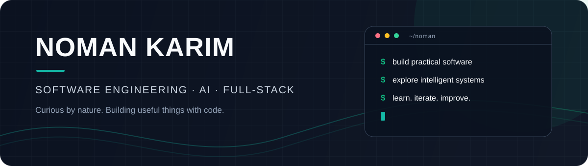

<p align="center">
  
</p>

<p align="center">
  <strong>Building intelligent, practical software—one project at a time.</strong>
  <br />
  Computer Science &amp; Engineering undergraduate at City University, Bangladesh
</p>

<p align="center">
  <a href="https://github.com/nomankarim8">GitHub</a>
  ·
  <a href="https://nomankarim8.github.io/nomanakarim8-Portfolio/">Portfolio</a>
  ·
  <a href="mailto:karimnoman97@gmail.com">Email</a>
</p>

---

## About

I'm a CSE undergraduate interested in building useful software and exploring how intelligent technology can solve practical problems. My projects span web applications, automation, and computer vision.

- 🎓 Studying Computer Science &amp; Engineering at City University, Bangladesh.
- 🧩 Interested in software engineering, full-stack development, AI/ML, computer vision, and databases.
- 🌱 Currently exploring Go and continuing to grow through hands-on projects.
- 🤝 Open to thoughtful collaboration on practical software and open-source projects.

## Areas I'm Exploring

- Artificial intelligence and machine learning
- Full-stack web application development
- Computer vision and license-plate recognition
- Backend systems and database design
- Ethical cybersecurity

## Featured Projects

### 01 · [Smart AI-Based Vehicle Parking Management System](https://github.com/nomankarim8/smart-parking)

A full-stack parking-management project combining vehicle and slot operations with a camera-assisted ALPR workflow and an operations dashboard. Plate recognition and external integrations depend on separately configured models, services, and hardware.

<sub>FULL-STACK · COMPUTER VISION</sub>

**Stack** · Python · FastAPI · React · TypeScript · MySQL/MariaDB · OpenCV

### 02 · [Ncover — Academic Cover Page Generator](https://github.com/nomankarim8/Ncover)

A web app for creating assignment and lab-report cover pages, previewing an A4 layout, and exporting a print-ready PDF.

<sub>WEB APPLICATION · PDF GENERATION</sub>

**Stack** · React · TypeScript · Tailwind CSS · html2canvas · jsPDF

### 03 · [Project NILA — AI Voice Assistant](https://github.com/nomankarim8/Project-NILA)

A Python voice-assistant prototype with speech input and output, text fallback, conversational responses through the OpenAI API, and simple website-opening commands.

<sub>PYTHON · VOICE ASSISTANT</sub>

**Stack** · Python · OpenAI API · SpeechRecognition · pyttsx3

## Technical Toolkit

These are technologies I've worked with or explored; the badges are not claims of expert-level proficiency.

**Languages**


`C` · `PHP` · `SQL`

**Frontend**


`HTML5` · `CSS3` · `Bootstrap`

**Backend & data**


`SQLite`

**AI and computer vision**


**Currently learning**


**Tools and platforms**


`Linux` · `Windows`

## GitHub

<p align="center">
  
</p>

The card shows public GitHub statistics and is provided by an external service. If it is unavailable, visit my [GitHub profile](https://github.com/nomankarim8), which remains the source of truth.

My contribution activity is visible on the [GitHub profile](https://github.com/nomankarim8).

## A Small Python Example

```python
def fibonacci(n: int) -> int:
    if n < 0:
        raise ValueError("n must be non-negative")

    previous, current = 0, 1
    for _ in range(n):
        previous, current = current, previous + current
    return previous
```

## Contact

If you're working on a practical software project and would like to collaborate, feel free to reach out.

- **Email:** [karimnoman97@gmail.com](mailto:karimnoman97@gmail.com)
- **Portfolio:** [nomankarim8.github.io/nomanakarim8-Portfolio](https://nomankarim8.github.io/nomanakarim8-Portfolio/)
- **GitHub:** [github.com/nomankarim8](https://github.com/nomankarim8)

<p align="center"><em>Let's build something useful together.</em></p>
