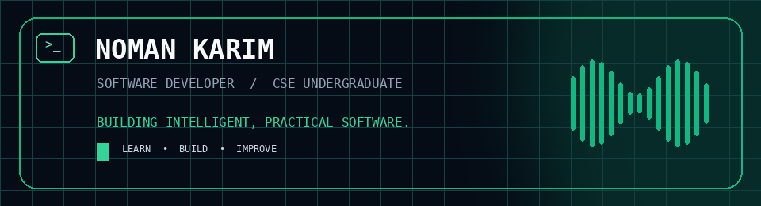
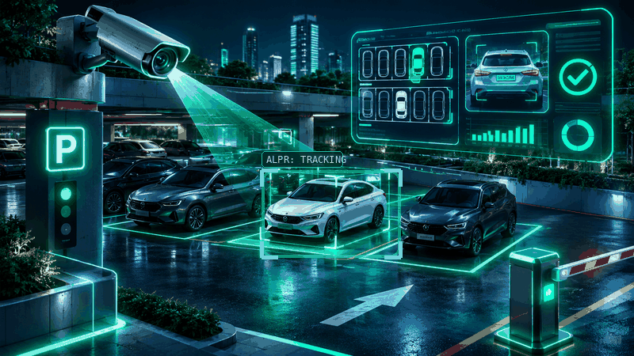
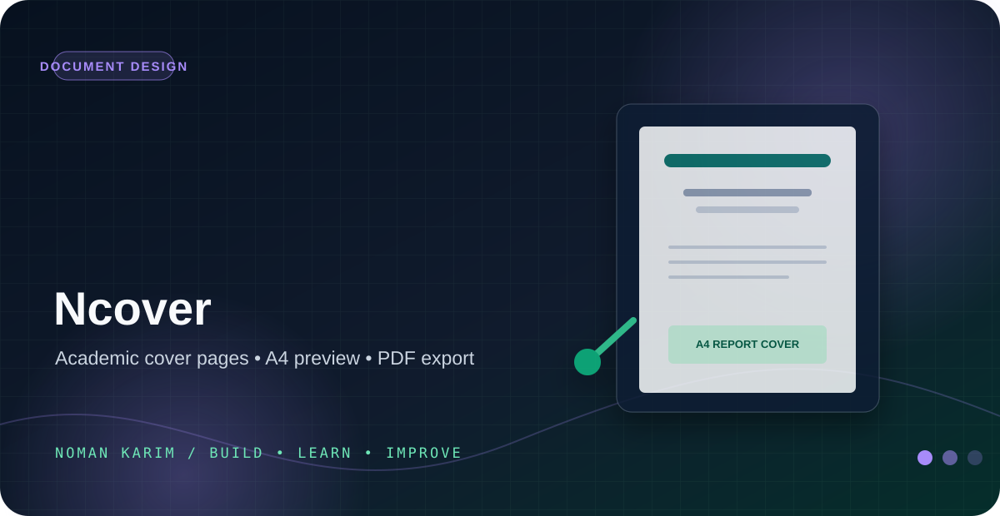
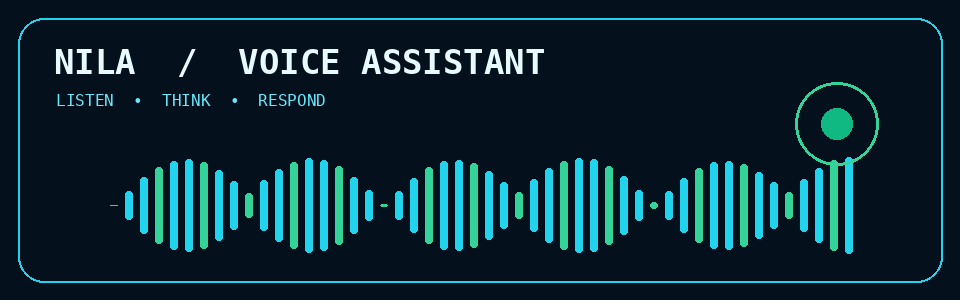
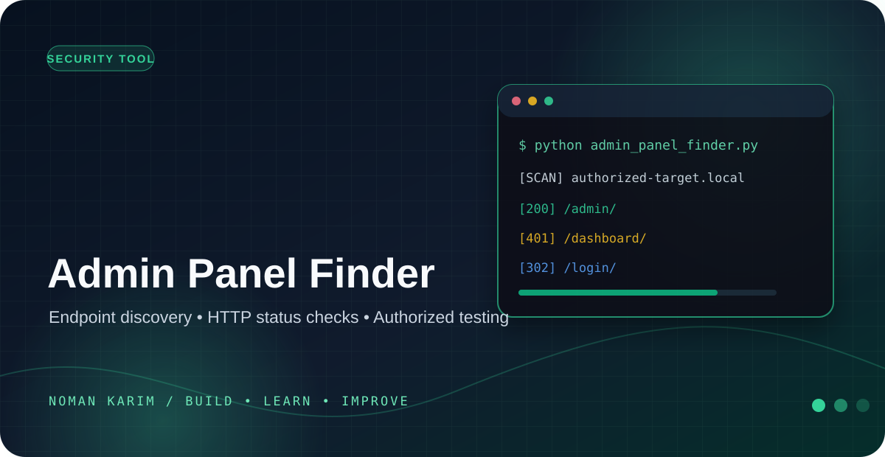
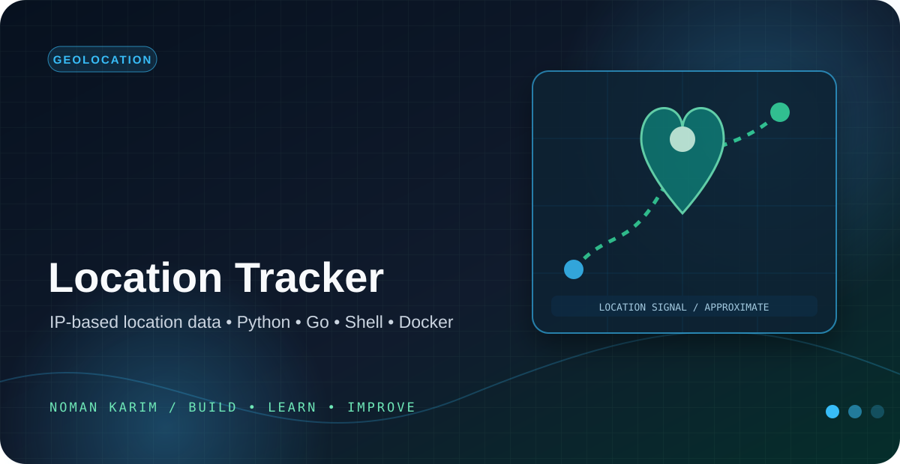
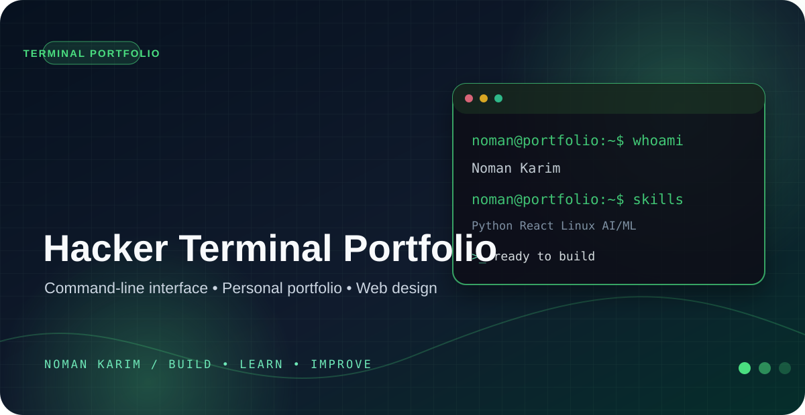
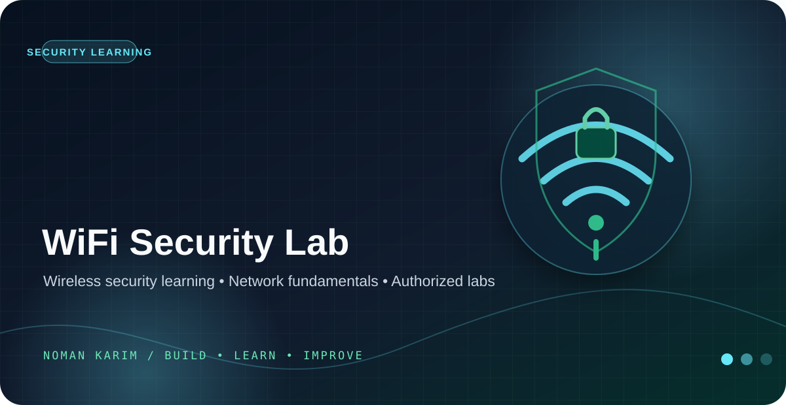
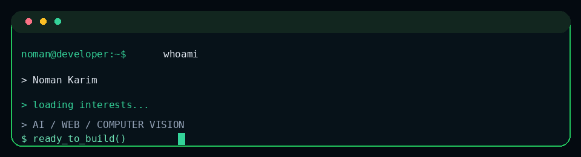
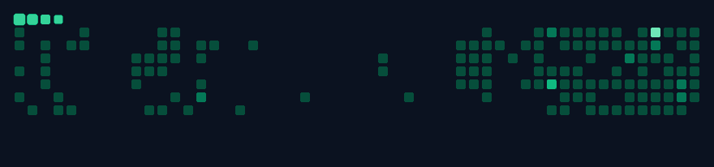

<!-- =========================================================
     NOMAN KARIM | GitHub Profile README
     Repository: https://github.com/nomankarim8/nomankarim8
     Theme: Midnight Navy · Emerald · Teal
     ========================================================= -->

<div align="center">

  <!-- Animated original header -->
  

  <br />


  <br /><br />

  <a href="https://github.com/nomankarim8">
    
  </a>
  <a href="https://nomankarim8.github.io/nomanakarim8-Portfolio/">
    
  </a>
  <a href="mailto:karimnoman97@gmail.com">
    
  </a>

  <br /><br />

  
  &nbsp;
  

  <br /><br />

  <sub>THINK DIFFERENTLY &nbsp;·&nbsp; BUILD INTELLIGENTLY &nbsp;·&nbsp; KEEP EVOLVING</sub>

</div>

---

<div align="center">

  **01 · ABOUT** &nbsp; | &nbsp; **02 · FOCUS** &nbsp; | &nbsp; **03 · PROJECTS** &nbsp; | &nbsp; **04 · STACK** &nbsp; | &nbsp; **05 · ACTIVITY** &nbsp; | &nbsp; **06 · CONTACT**

</div>

## 01 / The person behind the code

<table>
  <tr>
    <td width="66%" valign="top">

**Hey, I'm Noman Karim.**

I'm a Computer Science & Engineering undergraduate at **City University, Bangladesh**. I enjoy exploring technology and turning ideas into useful software.

I’m especially interested in software engineering, full-stack development, AI/ML, computer vision, automation, and ethical cybersecurity.

- 🎓 Studying Computer Science & Engineering.
- 💻 Building practical web and software projects.
- 🤖 Exploring AI, machine learning, and intelligent automation.
- 👁️ Interested in computer vision, OCR, and ALPR.
- 🗄️ Learning backend development and database design.
- 🔐 Exploring responsible security testing and web security.
- 🌱 Currently learning Go.
- 🤝 Open to thoughtful collaboration and open-source projects.

    </td>
    <td width="34%" align="center" valign="middle">
      
      <br /><br />
      <strong>NOMAN KARIM</strong>
      <br />
      <sub>Developer in progress</sub>
      <br /><br />
      
      <br />
      
      <br />
      
    </td>
  </tr>
</table>

> Understand the problem. Design the solution. Build something useful.

## 02 / What I'm exploring

<table>
  <tr>
    <td width="50%" valign="top">
      <h3>🤖 Artificial Intelligence</h3>
      Exploring AI-powered applications, machine learning concepts, and practical automation.
    </td>
    <td width="50%" valign="top">
      <h3>🌐 Full-Stack Development</h3>
      Building web interfaces, APIs, backend services, and database-driven applications.
    </td>
  </tr>
  <tr>
    <td width="50%" valign="top">
      <h3>👁️ Computer Vision</h3>
      Interested in image processing, OCR, object detection, and Automatic License Plate Recognition.
    </td>
    <td width="50%" valign="top">
      <h3>🔐 Ethical Cybersecurity</h3>
      Learning networking and application security with an emphasis on authorized testing.
    </td>
  </tr>
</table>

<div align="center">
  
  
  
</div>

---

## 03 / Project gallery

<div align="center">
  <sub>A visual tour of selected projects and experiments.</sub>
</div>

<table>
  <tr>
    <td width="50%" valign="top">
      <a href="https://github.com/nomankarim8/smart-parking">
        
      </a>
      <h3>🚘 Smart AI-Based Vehicle Parking</h3>
      A parking-management system combining slot operations, camera-assisted vehicle identification, and an ALPR workflow.
      <br /><br />
      
      
      
      
      <br />
      <a href="https://github.com/nomankarim8/smart-parking"><strong>View repository →</strong></a>
    </td>
    <td width="50%" valign="top">
      <a href="https://github.com/nomankarim8/Ncover">
        
      </a>
      <h3>📄 Ncover — Academic Cover Page Generator</h3>
      A web app for creating, previewing, and exporting A4 assignment and laboratory-report covers.
      <br /><br />
      
      
      
      <br />
      <a href="https://github.com/nomankarim8/Ncover"><strong>View repository →</strong></a>
      &nbsp;·&nbsp;
      <a href="https://nomankarim8.github.io/Ncover/"><strong>Live demo →</strong></a>
    </td>
  </tr>
  <tr>
    <td width="50%" valign="top">
      <a href="https://github.com/nomankarim8/Project-NILA">
        
      </a>
      <h3>🎙️ Project NILA — AI Voice Assistant</h3>
      A Python voice-assistant prototype with speech interaction, conversational AI, voice responses, and simple website-opening commands.
      <br /><br />
      
      
      
      <br />
      <a href="https://github.com/nomankarim8/Project-NILA"><strong>View repository →</strong></a>
    </td>
    <td width="50%" valign="top">
      <a href="https://github.com/nomankarim8/Admin-Panel-Finder">
        
      </a>
      <h3>🛡️ Admin Panel Finder</h3>
      A lightweight Python CLI utility that checks common web paths and reports HTTP response categories for authorized security assessments.
      <br /><br />
      
      
      <br />
      <a href="https://github.com/nomankarim8/Admin-Panel-Finder"><strong>View repository →</strong></a>
      <br />
      <sub>Use only on systems you own or are explicitly authorized to assess.</sub>
    </td>
  </tr>
  <tr>
    <td width="50%" valign="top">
      <a href="https://github.com/nomankarim8?tab=repositories">
        
      </a>
      <h3>📍 Location Tracker</h3>
      A portfolio-listed experiment for retrieving approximate location information from an IP address, described as using Python, Go, Shell, and Docker.
      <br /><br />
      
      
      
      <br />
      <a href="https://github.com/nomankarim8?tab=repositories"><strong>Find in my repositories →</strong></a>
    </td>
    <td width="50%" valign="top">
      <a href="https://github.com/nomankarim8?tab=repositories">
        
      </a>
      <h3>⌨️ Hacker Terminal Portfolio</h3>
      A terminal-inspired portfolio concept for presenting profile information, skills, projects, and contact details through a command-line-style interface.
      <br /><br />
      
      
      <br />
      <a href="https://github.com/nomankarim8?tab=repositories"><strong>Find in my repositories →</strong></a>
    </td>
  </tr>
  <tr>
    <td width="50%" valign="top">
      <a href="https://github.com/nomankarim8?tab=repositories">
        
      </a>
      <h3>📡 WiFi_Hack / Wireless Security Learning</h3>
      A portfolio-listed cybersecurity learning project. Wireless-security testing should be limited to personally owned equipment or explicitly authorized lab environments.
      <br /><br />
      
      
      <br />
      <a href="https://github.com/nomankarim8?tab=repositories"><strong>Find in my repositories →</strong></a>
    </td>
    <td width="50%" valign="top">
      
      <h3>🧪 More experiments</h3>
      I keep exploring new ideas and building projects as I learn. The repository page is the best place to see the full and current list.
      <br /><br />
      <a href="https://github.com/nomankarim8?tab=repositories"><strong>Browse all public repositories →</strong></a>
    </td>
  </tr>
</table>

<sub>Note: The Location Tracker, Hacker Terminal Portfolio, and WiFi_Hack titles were listed in my portfolio. Their exact repository URLs were not confirmed when this README was prepared, so those cards link to my repository list rather than guessing a URL.</sub>

---

## 04 / My technology toolbox

<div align="center">

  **LANGUAGES**
  <br /><br />
  

  <br /><br />
  **FRONTEND**
  <br /><br />
  

  <br /><br />
  **BACKEND & DATA**
  <br /><br />
  

  <br /><br />
  **AI, COMPUTER VISION & TOOLS**
  <br /><br />
  

</div>

<sub>These are technologies I have worked with, used in projects, or explored. My proficiency varies by technology.</sub>

---

## 05 / GitHub dashboard

<div align="center">

  
  

  <br /><br />

  

  <br /><br />

  

</div>

### 🐍 Contribution animation

The snake animation is generated by GitHub Actions. After the workflow runs successfully for the first time, the GIF below will appear automatically.

<div align="center">
  
</div>

---

## 06 / Inside my terminal

<div align="center">
  
</div>

```python
class Developer:
    def __init__(self, name):
        self.name = name
        self.values = ["Curiosity", "Consistency", "Creativity"]

    def next_step(self):
        return "Learn -> Build -> Improve"

me = Developer("Noman Karim")
print(me.next_step())
```

---

## 07 / Let's connect

<div align="center">

  **Good ideas become better when we build together.**

  <br />

  <a href="https://github.com/nomankarim8">
    
  </a>
  <a href="https://nomankarim8.github.io/nomanakarim8-Portfolio/">
    
  </a>
  <a href="mailto:karimnoman97@gmail.com">
    
  </a>

  <br /><br />

  

  <sub>Designed with curiosity ♥ by Noman Karim</sub>
  <br />
  <sub>Keep creating. Keep exploring. Keep moving forward.</sub>

</div>

<!-- End of profile README -->
